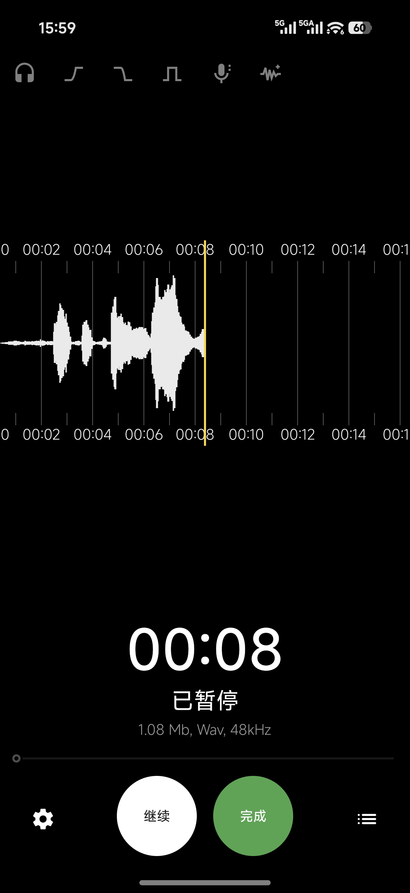
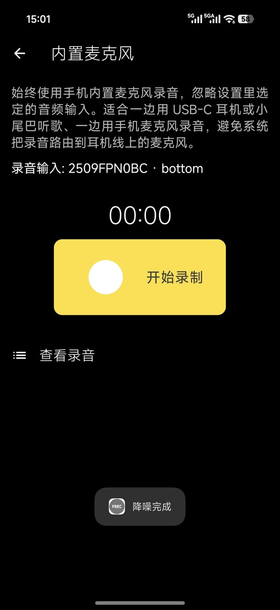

# FRecorder

> This fork is based on [vdo/FRecorder](https://github.com/vdo/FRecorder). 中文说明见 [README.md](./README.md).

<p align="center">  </p>

**FRecorder** is a free, open-source, easy-to-use field recorder — comfortable for recording thoughts and quick notes, and capable of some light professional work.

<p align="center">
  
  
</p>

## Changes

- **Explicit audio input selection** — the audio input list now includes every input reported by the system.
- **Quick built-in-mic recording** — app-icon long-press entry (Settings → *Quick record with built-in microphone*), records with the built-in mic right away.
- **Full Simplified Chinese localization** — every string translated.
- **Reworked the howling-risk check for an explicitly selected built-in microphone**

## Features

- Aside from the changes above, features are unchanged — see [vdo/FRecorder](https://github.com/vdo/FRecorder).

## Disclaimer

- The author of this fork is not a professional. The device-selection changes and the Chinese localization were made for personal use; no guarantee is given for anything else.

## Credits

- **Direct upstream**: [vdo/FRecorder](https://github.com/vdo/FRecorder) — the entire baseline of this fork comes from that project; thanks to its maintainer.
- Original project: FRecorder is based on [Audio Recorder](https://github.com/Dimowner/AudioRecorder) by Dmytro Ponomarenko.

## License

```txt
Copyright 2019 Dmytro Ponomarenko
Copyright 2026 vdo
Copyright 2026 KNSOR

Licensed under the Apache License, Version 2.0 (the "License");
you may not use this file except in compliance with the License.
You may obtain a copy of the License at

http://www.apache.org/licenses/LICENSE-2.0

Unless required by applicable law or agreed to in writing, software
distributed under the License is distributed on an "AS IS" BASIS,
WITHOUT WARRANTIES OR CONDITIONS OF ANY KIND, either express or implied.
See the License for the specific language governing permissions and
limitations under the License.
```
